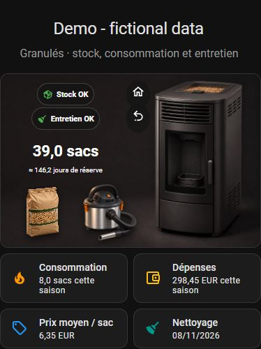

# Pellet Tracker · Suivi Granulés

**Stock, saisons de chauffe, coûts et entretien de votre poêle dans Home Assistant.**

[English](README.md) · [Nouveautés](CHANGELOG.md) · [Signaler un problème](https://github.com/oOBenjaminOo/ha-pellet-tracker/issues)



Projet original de [@oOBenjaminOo](https://github.com/oOBenjaminOo), utilisable avec
un poêle connecté ou non. Aucun compte cloud ni serveur MQTT n’est nécessaire au suivi.

**Version 0.9.0b1 : bêta.** Installation possible comme dépôt personnalisé HACS.
L’intégration n’est pas encore dans le catalogue par défaut. Une version stable et
la demande d’inclusion suivront la validation des essais.

## Fonctions

- Six vues séparées : Accueil, Statistiques, Saisons, Historique, Dashboards et Réglages.
- Un bouton « Ajouter une action » avec formulaire adapté à l’opération.
- Consommation, achats, nettoyage, premier allumage, fin de chauffe, pertes et corrections.
- Achats avec prix du sac facultatif, livraison, remise, fournisseur et marque.
- Saisons automatiques, report du stock, graphiques mensuels et comparaisons.
- Coûts FIFO : les sacs les plus anciens sortent en premier. Dépenses d’achat et
  coût des sacs consommés sont distincts ; les coûts incomplets sont signalés.
- Autonomie estimée, alertes de stock et d’entretien paramétrables, notifications et rappels.
- Budget facultatif par saison, bilan de chauffe et export PDF.
- Annulation immédiate de la dernière saisie, corrections tracées, conflits d’écriture refusés.
- Sauvegarde JSON, restauration avec aperçu et copies de récupération locales.
- Français/anglais, plusieurs poêles indépendants, 25 entités natives par poêle.
- Carte prête à ajouter au dashboard : sac et aspirateur cliquables, badges
  dynamiques, poêle allumé/éteint et vitre propre/sale.
- Observation d’un poêle connecté et commande de switch facultatives et indépendantes.

## Installation HACS

[](https://my.home-assistant.io/redirect/hacs_repository/?owner=oOBenjaminOo&repository=ha-pellet-tracker&category=integration)

Prérequis : **Home Assistant 2026.7.0 minimum** (essais sur 2026.7.1). Mushroom est
nécessaire uniquement pour la carte illustrée. Home Assistant installe ReportLab
4.4.10 pour les PDF. Internet sert à l’installation et aux mises à jour ; le journal reste local.

1. Dans HACS, ouvrir **Dépôts personnalisés**. Sur la nouvelle interface Marketplace,
   utiliser **Ajouter grâce à un lien** et coller l’adresse du dépôt.
2. Ajouter `https://github.com/oOBenjaminOo/ha-pellet-tracker`, catégorie **Intégration**.
3. Télécharger **Pellet Tracker**. Pendant la bêta, choisir la branche par défaut
   si aucune release n’est encore publiée.
4. Redémarrer Home Assistant.
5. **Paramètres → Appareils et services → Ajouter une intégration → Pellet Tracker**.
6. Choisir le nom, la langue, la devise, le premier mois de saison et les seuils.
7. Ouvrir **Pellet Tracker** dans la barre latérale.

Installation manuelle : copier uniquement `custom_components/pellet_tracker` dans
le dossier `custom_components` de HA, puis redémarrer et ajouter l’intégration.
Les mises à jour du code nécessitent un redémarrage ; les réglages s’appliquent sans redémarrer.

## Démarrer le suivi

Le journal neuf est vide. Pour les sacs déjà possédés, saisir une **correction de
stock positive**, avec leur prix seulement s’il est connu. Une correction n’est
pas un achat. Enregistrer ensuite les réapprovisionnements et les sacs consommés.

Le mois initial, choisi à la création (juillet par défaut), reste fixe pour préserver
l’historique. Les saisons basculent automatiquement et le stock est conservé.
Le premier allumage est un repère de chauffe distinct et ne consomme aucun sac.
Les saisies rétroactives utilisent leur date propre.

Les seuils se règlent dans **Accueil → Modifier mes seuils** ou **Réglages**.
Stock faible : quantité inférieure ou égale au seuil. Entretien : nombre de sacs,
jours écoulés ou les deux. Zéro désactive le seuil correspondant. Le rappel en
jours nécessite une consommation depuis le dernier nettoyage.

## Ajouter la carte au dashboard

Installer **Mushroom** dans HACS, puis **Dashboards → Ajouter à un dashboard**.
Choisir le tableau, la vue et la section, puis confirmer. La carte suit ensuite
la langue et les réglages du poêle automatiquement.

Pour une carte manuelle, remplacer l’identifiant d’exemple :

```yaml
type: custom:pellet-tracker-card
entry_id: IDENTIFIANT_DU_SUIVI
```

Aucune ressource JavaScript supplémentaire à déclarer. Les anciennes cartes
Mushroom statiques peuvent être remplacées une fois par la carte automatique.
Les 20 capteurs, 3 capteurs binaires et 2 boutons restent utilisables séparément.
Les dashboards YAML, vues générées et vues Panneau déjà occupées demandent un ajout manuel.

## Poêle connecté, en option

Dans **Réglages → Poêle connecté → Assistant de configuration**, choisir l’entité
existante, éventuellement son attribut, puis les valeurs exactes allumé/éteint.
Une valeur inconnue ou indisponible n’est pas assimilée à un arrêt.
Pour MQTT/Tasmota, exposer d’abord l’appareil dans HA avec l’intégration correspondante.

La commande est **désactivée par défaut**. Choisir explicitement le switch et
activer l’option pour que le clic sur le poêle demande confirmation avant d’envoyer
la commande. L’assistant ne déclenche aucune commande. Le suivi n’implémente pas
les séquences d’allumage ni les sécurités propres au fabricant.

## Sauvegarder, restaurer et supprimer un poêle

Le journal est dans `/config/.storage/pellet_tracker.<entry_id>`, indépendamment
de Recorder. Sa purge ne supprime ni les achats, ni les consommations, ni les
anciennes saisons. Les mises à jour et redémarrages conservent le journal.
L’historique Recorder des capteurs suit, lui, la rétention habituelle de HA.

Dans **Historique ou Réglages → Sauvegarde et restauration**, télécharger le JSON.
Une sauvegarde HA incluant la configuration conserve aussi le journal. Garder
une copie hors de la machine : la récupération locale ne protège pas d’une panne disque.

Pour restaurer, choisir un fichier JSON ou coller son contenu. L’aperçu vérifié
par le serveur présente les saisons, opérations, identifiants existants/nouveaux,
opérations actuelles absentes du fichier, annulations et stock résultant.
Cocher la confirmation, puis **Restaurer le journal**. Un conflit de révision ou
un fichier modifié depuis l’aperçu empêche la restauration.

**La restauration remplace les opérations du journal**, y compris corrections et
annulations. Les réglages, destinations de notification, commandes et budgets
actuels restent inchangés ; les réglages exportés restent consultables dans le
fichier. La devise et le mois de saison doivent correspondre. L’ancien audit du
fichier n’est pas réimporté : une nouvelle trace de restauration est enregistrée.
Le journal précédent complet est conservé dans la copie de récupération.

Avant la restauration ou lors d’une suppression par HA, une copie est sauvegardée
dans `.storage/pellet_tracker_recovery.<entry_id>`. La suppression retire les
entités et le journal actif, mais conserve cette copie. Pour récupérer un poêle
supprimé, créer un suivi avec la même devise et le même mois initial, puis choisir
**Rechercher les copies de récupération** et vérifier l’aperçu.
Une copie par suivi est conservée : une restauration ultérieure remplace sa copie
précédente. Aucune purge automatique de ces copies n’est programmée. Un échec de
sauvegarde empêche la suppression du fichier actif.

L’**import d’historique** est différent : il fusionne les nouveaux identifiants et
ignore ceux déjà présents. Il ne restaure pas leurs corrections. L’outil local
`tools/convert_xlsx.py` accepte l’ancien format Excel français pris en charge ;
`openpyxl` est nécessaire uniquement sur la machine de conversion. Ne jamais publier son résultat.

## Comprendre les chiffres

- Les sacs consommés sont les sacs ajoutés au poêle, pas une mesure de chaleur ou de combustible brûlé.
- L’autonomie est une estimation selon les saisies récentes, sans prévision météo.
- Un prix manquant reste inconnu. Ne pas comparer un coût partiel à un coût complet.
- Prix sur quatre décimales maximum, affichage monétaire sur deux, calculs Decimal.
- Une devise par suivi, sans conversion. Tout stock négatif, même historique, est refusé.
- Les rappels d’entretien utilisent vos seuils et ne remplacent pas les prescriptions du fabricant.
- Le panneau et les API du journal sont réservés aux administrateurs. Les permissions HA
  des entités restent applicables aux utilisateurs des dashboards.

## Automatisations et assistance

Actions : `pellet_tracker.record`, `edit`, `cancel`, `restore`, `export`, `undo_last`,
`check_notifications`, `test_notification`, `control_stove`. Le sélecteur de suivi
cible le bon poêle. L’action `restore` rétablit une opération annulée ; la restauration
JSON complète utilise le panneau. `export` retourne le journal dans sa réponse.

Après mise à jour, redémarrer HA et actualiser le navigateur ou Companion.
Si la carte est inconnue, vérifier le chargement de l’intégration et l’installation
de Mushroom. Consulter **Paramètres → Système → Journaux**, filtre `pellet_tracker`.
Pour un problème, préciser versions, langue, étapes et capture anonymisée dans
[une issue](https://github.com/oOBenjaminOo/ha-pellet-tracker/issues).
Ne jamais joindre le journal JSON, le fichier Excel ou les destinations privées.
**Les captures et exemples du dépôt utilisent uniquement des données fictives.**

La CI vérifie les tests Python/Node, Ruff, Prettier, hassfest et HACS.
[Liste de préparation à la publication](docs/release-checklist.md).
L’inclusion HACS reste soumise à une demande et une revue séparées, après validation.

Licence [MIT](LICENSE). Les illustrations ne représentent aucune affiliation à un fabricant.
