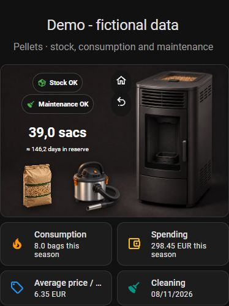

# Pellet Tracker

**Pellet stock, heating seasons, costs and maintenance - entirely in Home Assistant.**

[Français](README.fr.md) · [Changelog](CHANGELOG.md) · [Report a bug](https://github.com/oOBenjaminOo/ha-pellet-tracker/issues)



Pellet Tracker is an original custom integration by [@oOBenjaminOo](https://github.com/oOBenjaminOo).
It works with any pellet stove, including an unconnected stove. No cloud account,
MQTT broker or manufacturer integration is required to track bags.

**Current version: 1.0.0 - first stable release.** Included in the default HACS
catalog following the merge of [hacs/default#13692](https://github.com/hacs/default/pull/13692).
This project is independent of Home Assistant and HACS.

## Features

- Separate Home, Statistics, Seasons, History, Dashboards and Settings views.
- Quick action dialog for consumption, purchases, cleaning and other journal entries.
- Purchases with optional unit price, shipping, discount, supplier and pellet brand.
- Automatic heating seasons, stock carried forward, monthly graphs and comparisons.
- FIFO valuation: oldest bags are consumed first; purchase spending and consumed
  bag cost are distinct. Unknown prices remain unknown, with an explicit partial-cost notice.
- Estimated autonomy based on recent recorded consumption; no weather prediction.
- Configurable stock and cleaning thresholds, grouped notifications and reminders.
- Optional season budget, heating start/end dates and downloadable PDF season report.
- Reversible entry cancellation, immediate undo of the latest addition, revision checks.
- JSON backups, server-validated restore preview and automatic local recovery copies.
- French/English per tracker, local number/date formatting and translated messages.
- Multiple independent stoves; 20 sensors, 3 binary sensors and 2 buttons per stove.
- Ready-to-add dashboard card, with clickable bag and ash vacuum, dynamic stock and
  cleaning badges, and four stove images (on/off × clean/dirty).
- Optional observed stove state and separately enabled, confirmed switch control.

## Requirements

| Component | Requirement |
| --- | --- |
| Home Assistant | 2026.7.0 or later; tested on 2026.7.1 |
| HACS | Required only for HACS installation/updates |
| Mushroom | Required for the illustrated ready-made dashboard card |
| Internet | Required for installation/dependencies/updates; journal runs locally |
| Stove connection | Optional; an existing HA entity is used for observation/control |

Home Assistant installs `reportlab==4.4.10` for local PDF generation. The panel
and native entities work without Mushroom. Monetary values use one currency per
tracker, with no exchange-rate conversion.

## Install with HACS

1. Open HACS (or **Marketplace** on newer versions) and search for **Pellet Tracker**.
2. Open **Pellet Tracker** and install the latest stable release.
3. Restart Home Assistant.
4. Open **Settings → Devices & services → Add integration → Pellet Tracker**.
5. Choose the tracker name, language, currency, season start month and alert thresholds.
6. Open **Pellet Tracker** in the sidebar.

### Fallback: custom repository

If Pellet Tracker does not appear yet, refresh the HACS catalog. If your local
catalog has not picked up the addition, you can add the repository manually:

[](https://my.home-assistant.io/redirect/hacs_repository/?owner=oOBenjaminOo&repository=ha-pellet-tracker&category=integration)

In HACS, open **Custom repositories**, add
`https://github.com/oOBenjaminOo/ha-pellet-tracker` with category **Integration**,
then install Pellet Tracker and follow steps 3–6 above. On newer Marketplace
screens, use **Add using a link** and paste the repository URL.

Manual alternative: copy only `custom_components/pellet_tracker` into your
Home Assistant `custom_components` directory, restart, then add the integration.
Code updates require a restart; changing tracker settings does not.

## First use

Start with an empty journal. Record an initial positive stock adjustment for bags
already owned, including their price only if known; an adjustment is not a purchase.
Record subsequent purchases with their quantity and optional price per bag.
Use **Add an action** to record bags consumed or cleaning.

The season start month is chosen at setup (July by default). Seasons roll over
automatically, without resetting stock. The first lighting date is a separate
heating marker and never consumes a bag. Historical entries use their own dates.
The start month stays fixed to preserve historical consistency.

Cleaning alerts can use a bag threshold, elapsed days, or both. A zero disables
that individual threshold; day reminders require consumption since cleaning.
Stock alerts trigger at or below your configured threshold. All are user-adjustable.

## Add the dashboard card

Install **Mushroom** from HACS. In **Pellet Tracker → Dashboards → Add to a dashboard**,
choose a storage-managed dashboard, view and section, then confirm. The live card
follows the tracker language and settings automatically.

Manual card configuration (replace the placeholder with your tracker ID):

```yaml
type: custom:pellet-tracker-card
entry_id: YOUR_TRACKER_ENTRY_ID
```

The card is registered by the integration; no additional JS resource is needed.
Existing old static Mushroom cards can be replaced once with the live card.
Native sensors also work in your own cards and automations. YAML dashboards,
strategy-generated views and occupied panel views require manual placement.

The dashboard setup wizard offers a **Fully editable card** made of individual
cards. Clear that option to keep the automatic wrapper, which follows tracker
settings. Use the editable option to replace an existing automatic card if you
want to customise its layout.

The stove's device page includes a link to its tracker. In the stove's
integration options, **Show Pellet Tracker in the sidebar** controls the shared
shortcut. With multiple stoves, the shortcut appears if any stove enables it.

## Connected stove (optional)

**Settings → Connected stove → Setup assistant** guides observation, optional
control and review. Select an existing entity, optionally an attribute, and the
exact values that mean on/off. Unknown or unavailable readings are not treated as off.
Tasmota/MQTT users first expose their device through the relevant HA integration.

Control is **disabled by default** and independent of observation. Explicitly
select the switch and enable control to make the stove image ask for confirmation
before sending an on/off command. The setup assistant sends no device command.
No manufacturer safety or ignition sequence is implemented by this tracker.

## Backups, restore and removal

Journal data is stored in `/config/.storage/pellet_tracker.<entry_id>` separately
from Recorder. Recorder purges do not remove purchases, consumption or seasons.
Normal integration updates and restarts preserve the journal. Sensor Recorder
history follows Home Assistant's usual retention settings.

Use **History or Settings → Backup and restore → Download JSON backup**.
A Home Assistant backup that includes its configuration also preserves the journal.
Keep an off-device backup: local recovery copies do not protect against disk loss.

To restore, choose **Restore a backup**, select a JSON file (or paste JSON), and
check the server-validated preview: seasons, operations, existing/new IDs, current
operations absent from the backup, voided entries and resulting stock. Tick the
replacement confirmation and restore. A stale journal or changed backup is refused.

**Restore replaces the journal operations, rather than merging them.** It restores
corrections and voided flags. Current tracker settings, notification destinations,
control options and budgets are not changed; exported settings remain available
in the file for reference. Currency and season start month must match.
The backup's old audit is not trusted/imported: restoration is logged in the
current audit. The whole previous journal is retained in the local recovery copy.

Before restore, or when deleting a tracker through HA, the integration saves the
journal to `.storage/pellet_tracker_recovery.<entry_id>`. Deleting the tracker
removes its active journal and entities, while retaining that recovery copy.
Create another tracker with the same currency/start month, then use **Find recovery
copies** to preview and restore it. One recovery copy per tracker is retained;
a later restore overwrites that tracker's previous recovery copy. There is no
scheduled purge of these copies. A save failure prevents active journal removal.

**Merge import** is separate, under **History → Import history**. It adds new IDs
and skips existing IDs; it does not restore corrections to existing records.
The optional `tools/convert_xlsx.py` converts the supported legacy French workbook
locally; install `openpyxl` on the conversion machine only. Never commit its output.

## Statistics and limitations

- Bags recorded as consumed measure bags put into the stove, not actual burned
  fuel, useful heat or measured energy.
- Autonomy needs recent observations and is an estimate, not a guarantee.
- Missing prices are never invented. Partial totals must not be compared as full costs.
- Prices support up to four decimals; money display rounds to two. FIFO uses Decimal.
- Negative stock, including an impossible historical stock sequence, is rejected atomically.
- Maintenance reminders reflect user settings, not a manufacturer's service schedule.
- The tracker panel and journal APIs require an administrator. Entity read/control
  permissions still apply to dashboard users.

## Automation actions

`pellet_tracker.record`, `edit`, `cancel`, `restore`, `export`, `undo_last`,
`check_notifications`, `test_notification` and `control_stove` are available in
Home Assistant's action editor. The entry selector targets the correct tracker.
`restore` here reinstates a cancelled operation; full JSON restore is a separate
panel workflow. Export returns a response containing the journal.

## Troubleshooting and support

After installing/updating, restart HA and refresh the browser/Companion frontend.
If the card reports an unknown custom element, check that the integration loaded
and Mushroom is installed. Use **Settings → System → Logs**, filtered for
`pellet_tracker`, and the integration diagnostics when reporting an issue.
Do not publish your JSON backup, workbook, notification targets or full journal.
Repository fixtures and screenshots use fictional examples only.

Include HA/integration versions, language, reproduction steps and a redacted
screenshot in [an issue](https://github.com/oOBenjaminOo/ha-pellet-tracker/issues).

## Development and HACS readiness

CI runs Python/Node regression tests, Ruff, Prettier, hassfest and HACS validation.
See [the release checklist](docs/release-checklist.md) for executed checks and
remaining acceptance gates. HACS catalog inclusion is a separate review; a passing
validation does not imply approval. User acceptance was granted before the first stable publication.

Licensed under [MIT](LICENSE). Included stove illustrations are illustrative assets;
no manufacturer affiliation is implied.
