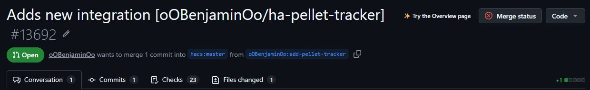

# Release checklist

## First stable release 1.0.0

- [x] Single `custom_components/pellet_tracker` package; local runtime assets included.
- [x] MIT license, issue tracker, code owner, config flow, versioned manifest.
- [x] Local brand icons; `hacs.json` renders README and declares minimum HA version.
- [x] French/English user documentation, custom repository installation instructions.
- [x] Journal restore validation, explicit replacement confirmation and recovery checkpoint.
- [x] Deleted tracker recovery archive; storage failure regression.
- [x] Partial-cost warning and translation regressions.
- [x] Existing journal unchanged: tests use independent fictional fixtures.
- [x] Live candidate deployed on HA test; restore preview/replacement, pre-restore recovery and deleted-tracker recovery into a fresh tracker verified on disposable trackers.
- [x] Chromium 390×844: dashboard, confirmed bag/cleaning actions, panel action dialog and restore controls checked; no horizontal main-panel overflow.
- [x] Marketplace custom link added and installation from default branch completed on HA test.
- [x] Stable CI run 42505446552: tests/formatting, hassfest and HACS validation succeeded without ignored checks.
- [x] User acceptance received; stable version selected: 1.0.0.
- [x] Published [v1.0.0](https://github.com/oOBenjaminOo/ha-pellet-tracker/releases/tag/v1.0.0) after stable commit validation.
- [x] Submitted [hacs/default#13692](https://github.com/hacs/default/pull/13692), open and ready for review, with maintainer edits enabled.

Native Android/iOS keyboard and physical touch are not certified by desktop
Chromium viewport tests. No real stove control is exercised during validation.
All published screenshots must use fictional records, without real IDs, targets,
network addresses or journal content. Never include private JSON/Excel sources.

Executed live checks: empty tracker setup; restore a fictional nine-operation
backup across two seasons; confirmed image bag action; restore over nine existing
IDs and remove the extra current operation; confirmed cleaning and live language
change; recovery preview on mobile; delete demo tracker; restore its ten-operation
archive into a new tracker. Temporary dashboards, trackers and their recovery
copies are removed after validation. No stove switch command is sent.

Automated suite: 77 Python tests and 26 Node tests (103 total).

The catalog request is pending HACS review; submission is not catalog acceptance.
The latest submission preflight, release, owner, domain-conflict, HACS, hassfest,
JSON schema and sorting checks all passed.

